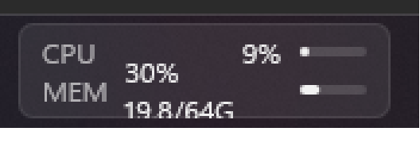
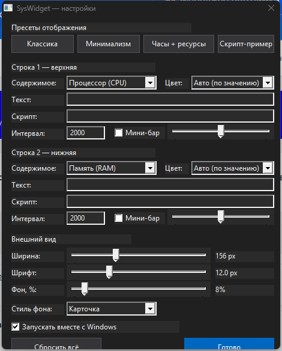
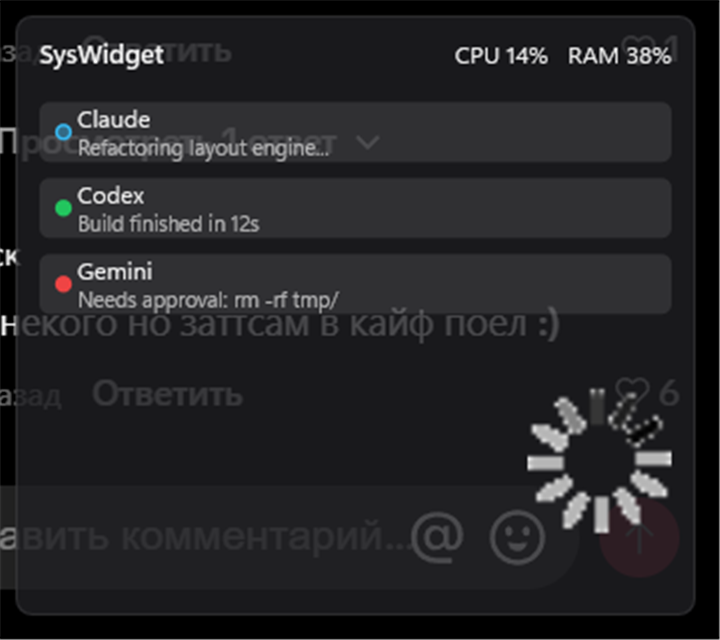

# SysWidget — нативный виджет CPU/RAM для панели задач Windows 11

Легковесный (~1 МБ, один статический `.exe`, без зависимостей) оверлей в левом углу
панели задач в стиле системного монитора Linux (i3status/waybar): две строки
`CPU` / `MEM` со значениями и мини-барами. Рендеринг — нативный WinAPI +
**Direct2D/DirectWrite** (Segoe UI Variable, Segoe Fluent Icons), полупрозрачная
карточка со скруглениями поверх Mica-панели задач. Клик по виджету — сводка с
графиками истории; клик по иконке в трее — меню.

```
┌────────────────────────┐
│ CPU        6%      ▂▁  │   ← значение + мини-бар загрузки
│ MEM   33%  21.3/64G ▄▄ │   ← %, занято/всего ГБ, мини-бар
└────────────────────────┘
```

Виджет (реальный скриншот, 3× зум):



Окно настроек (клик по виджету):



Flyout по клику: графики CPU/RAM, текущие значения, кастомные строки:


- Значения окрашиваются: >70% — жёлтый, >90% — красный (как в Linux-мониторах).
- Акцентный цвет баров берётся из системной темы Windows.
- Тема (светлая/тёмная), DPI и перезапуск explorer'а обрабатываются автоматически.

## Panel-режим и AI-агенты (v2.0)

```bash
# переключить в свободную панель с маскотом-GIF
./bin/SysWidget.exe --send '{"cmd":"config","mode":"panel","mascotPath":"C:/anim.gif","mascotWidth":72}'
# сообщить статус AI-агента (пайп \.\pipe\syswidget_agents_ipc или команда agent)
./bin/SysWidget.exe --send '{"cmd":"agent","id":"claude","name":"Claude","status":"working","status_text":"Refactoring..."}'
./bin/SysWidget.exe --send '{"cmd":"agent","id":"codex","name":"Codex","status":"done","status_text":"Build ok"}'
./bin/SysWidget.exe --send '{"cmd":"agent","id":"gemini","name":"Gemini","status":"attention","status_text":"Needs approval"}'
```

Панель ресайзится за края мышкой, перетаскивается за шапку; карточки агентов
(`working` — пульсирующий голубой, `done` — зелёный, `attention` — мигающий красный,
`offline` — скрыт) выстраиваются стеком автоматически. MCP-инструмент
`syswidget_status` и команды пайпа — без изменений. Цвета/радиусы/шрифты
настраиваются в `%APPDATA%\SysWidget	heme.json`. Архитектура — [ARCHITECTURE.md](ARCHITECTURE.md).



## Состав

| Файл | Назначение |
|---|---|
| `src/main.cpp` | вход, CLI (`--install`, `--send`, `--mcp`, …), сборка каркаса |
| `src/ui.h` | окно-оверлей, приклейка к панели задач, Direct2D-рендер, flyout, tray |
| `src/content.h` | модель 2 строк (cpu/ram/text/anim/script), конфиг, запуск скриптов |
| `src/pipe.h` | named-pipe сервер `\\.\pipe\SysWidget` (NDJSON) |
| `src/mcp.h` | MCP-мост (`--mcp`, JSON-RPC 2.0 over stdio) |
| `src/jsonlite.h`, `src/sampler.h`, `src/common.h` | мини-JSON, семплер CPU/RAM, утилиты |
| `build.bat` / `build.sh` | сборка одним вызовом (g++ / WinLibs / MSVC) |

## Установка

### В одну команду (PowerShell)

Скачивает готовый `SysWidget.exe` из [Releases](https://github.com/el1zabethcodes/SysWidget/releases),
кладёт в `%LOCALAPPDATA%\Programs\SysWidget`, включает автозапуск и стартует виджет:

```powershell
irm https://raw.githubusercontent.com/el1zabethcodes/SysWidget/main/install.ps1 | iex
```

Удаление:

```powershell
irm https://raw.githubusercontent.com/el1zabethcodes/SysWidget/main/install.ps1 -OutFile i.ps1; .\i.ps1 -Uninstall
```

Либо вручную: скачать `SysWidget.exe` из Releases → запустить → `SysWidget.exe --install` для автозапуска.
Один портативный exe, никаких зависимостей и прав администратора.

### Сборка из исходников

Требуется `g++` (например `winget install BrechtSanders.WinLibs.POSIX.UCRT` —
GCC/MinGW-w64 ставится одной командой) либо MSVC. На push в main сборка идёт
автоматически в GitHub Actions (артефакт `SysWidget.exe`), на тег `v*` — публикуется в Releases.

```bash
./build.sh   # Git Bash
build.bat    # cmd
```

### Замена штатной кнопки «Погода / Виджеты»

Виджет занимает левый угол панели задач. Чтобы убрать штатную кнопку Виджетов
(освободить место рядом со «Пуск»):

```bash
./bin/SysWidget.exe --hide-widgets   # TaskbarDa=0 + перезапуск explorer
./bin/SysWidget.exe --show-widgets   # вернуть
```

## Управление: `--send` (Named Pipe `\\.\pipe\SysWidget`)

Протокол — NDJSON (одна команда-JSON на строку, UTF-8), ответ `{"ok":true,...}`.

```bash
W=./bin/SysWidget.exe

$W --send '{"cmd":"status"}'                                  # CPU/RAM в JSON
$W --send '{"cmd":"line","index":0,"text":"deploy | OK","color":"#6CCB5F"}'
$W --send '{"cmd":"line","index":1,"text":"{time} · CPU {cpu}%"}'   # токены
$W --send '{"cmd":"lines","texts":["build | ✔","test | 42/42"]}'
$W --send '{"cmd":"anim","index":1,"frames":["⠋","⠙","⠹","⠸","⠼","⠴","⠦","⠧","⠇","⠏"],"intervalMs":90,"text":"building…"}'
$W --send '{"cmd":"script","index":1,"command":"powershell -NoProfile -c (Get-Date -Format HH:mm:ss)","intervalMs":2000}'
$W --send '{"cmd":"script.remove","index":1}'
$W --send '{"cmd":"bar","index":1,"value":0.75}'
$W --send '{"cmd":"notify","text":"✔ Сборка завершена","ms":4000}'
$W --send '{"cmd":"reset"}'
$W --send '{"cmd":"config","width":180,"fontSize":12.5,"align":"right"}'
$W --send '{"cmd":"save"}'
```

Возможности строк:

- **text** — произвольный текст. `метка | значение` раскрашивается в два тона.
  Токены: `{cpu} {ram} {ramUsed} {ramTotal} {time}`.
- **anim** — покадровая анимация (брайл-спиннеры, прогресс), задаётся агентом.
- **script** — первая строка stdout shell-команды обновляется по интервалу
  (выполняется скрытно, без окна консоли; таймаут 8 с; UTF-8, фолбэк OEM-кодировка).
- **notify** — временная акцентная надпись поверх верхней строки.
- **bar** — мини-бар 0..1 на любой строке.

Клик мышью по виджету — **окно настроек** (см. ниже). Правый клик по
tray-иконке — меню (настройки, сводка, сброс, автозапуск, config.json, выход);
левый клик по tray-иконке — flyout «Мониторинг системы» с графиками CPU/RAM.

## Настройки (окно по клику)

Все изменения применяются сразу и сохраняются в config.json:

- **Пресеты**: «Классика» (CPU+RAM с барами), «Минимализм» (только проценты),
  «Часы + ресурсы», «Скрипт-пример» (вторая строка из PowerShell).
- **Строки 1 и 2**: выбор содержимого — Процессор / Память / Текст (с токенами)
  / Скрипт / **Скрытая** (спрятать конкретный виджет; если скрыты обе — карточка
  исчезает). Для текста и скрипта — поле ввода, интервал опроса, мини-бар.
- **Цвет значения** каждой строки: авто/белый/зелёный/жёлтый/красный/голубой/…
- **Внешний вид**: ширина (96–280 px), размер шрифта, **прозрачность фона (0–100%)**,
  стиль фона (карточка / без фона).

Те же параметры доступны по пайпу: `{"cmd":"config","bgOpacity":30}`,
`{"cmd":"line",...}`, пресеты — только из окна настроек.

## Конфиг

`%APPDATA%\SysWidget\config.json` (создаётся автоматически, редактируется и из pipe):

```json
{
  "version": "1.0.0",
  "config": {
    "width": 156,          // px @96dpi (96–280)
    "fontSize": 12,        // px @96dpi (9–20)
    "align": "left",       // left | right угол панели задач
    "material": "card",    // card | flat | acrylic
    "renderer": "auto",    // auto|gdi (ULW+D2D, по умолчанию) | dcomp (D3D11+DirectComposition)
    "bgOpacity": 8,        // 0..100 — плотность фона карточки
    "trayIcon": true
  },
  "lines": [
    {"kind": "cpu"},       // cpu | ram | text | anim | script | hidden
    {"kind": "ram"}
  ]
}
```

Скрипты и кастомные строки сохраняются в этот же файл и переживают перезапуск.

## MCP-интеграция

Тот же exe работает как MCP-сервер (stdio, JSON-RPC 2.0) и сам поднимает виджет,
если он не запущен. Пример конфигурации клиента (ZCode / Claude Desktop / Cursor):

```json
{
  "mcpServers": {
    "syswidget": {
      "command": "C:\\Users\\<user>\\AppData\\Local\\Programs\\SysWidget\\SysWidget.exe",
      "args": ["--mcp"]
    }
  }
}
```

Инструменты (`tools/list`):

| Инструмент | Что делает |
|---|---|
| `syswidget_status` | живые CPU/RAM машины в JSON |
| `syswidget_set_line` | текст/иконка/цвет/бар на строку 0 или 1 |
| `syswidget_set_lines` | задать обе строки сразу |
| `syswidget_animate` | покадровая анимация (спиннер, прогресс) |
| `syswidget_script` | периодический shell-скрипт → строка виджета |
| `syswidget_script_remove` | снять скрипт, вернуть CPU/RAM |
| `syswidget_notify` | короткое уведомление на верхней строке |
| `syswidget_reset` | сброс к CPU/RAM |

Любой внешний агент может говорить и напрямую по пайпу (`\\.\pipe\SysWidget`,
NDJSON) без MCP — например, из PowerShell/Python/C#.

## Архитектура (коротко)

- **UI-поток**: окно `WS_EX_LAYERED + WS_EX_TOPMOST + UpdateLayeredWindow`, D2D DC
  RenderTarget → 32-битный premultiplied DIB; рендер по требованию (dirty-флаг),
  таймеры 100 мс (анимации) / 1 с (сэмплы, позиция). Альтернативный бэкенд
  `dcomp` — D3D11 + DirectComposition + swap chain с premultiplied alpha.
- **Позиционирование**: каждый тик сверяется с *фактическим* `GetWindowRect`
  (внешние сдвиги, смена DPI/монитора исправляются сразу), реакция на
  `WM_DISPLAYCHANGE`, `WM_SETTINGCHANGE`, `WM_DPICHANGED` и `TaskbarCreated`.
- **Не мигает при переключении окон**: `WS_EX_NOACTIVATE`, обработка
  `WM_MOUSEACTIVATE`, мгновенный ре-рейз по `SetWinEventHook`
  (EVENT_SYSTEM_FOREGROUND / EVENT_OBJECT_REORDER) плюс контроль z-порядка в
  тике позиционирования — окно поднимается выше панели задач только когда та
  действительно его перекрыла (без слепого таймера topmost).
- **Приклейка к панели**: `Shell_TrayWnd` → прямоугольник задачи, DPI,
  авто-скрытие/полный экран, `TaskbarCreated` (перезапуск explorer), перевод
  DPI/мониторов. Окно TOPMOST + TOOLWINDOW + NOACTIVATE (не мешает Alt-Tab).
- **Pipe-потоки**: 3 инстанса `\\.\pipe\SysWidget`, блокирующее чтение по `\n`.
- **Поток скриптов**: скрытый `cmd.exe /c` с пайпом stdout (без мигания консоли).
- Состояние — `SharedState` под SRWLOCK; pipe/MCP меняют строки и ставят dirty.
- Один экземпляр на сессию (мьютекс `Local\SysWidget.SingleInstance`).

## Ограничения

- Позиция — панель задач **основного** монитора (левый/правый угол).
- Строк ровно две (высота панели задач фиксирована); расширение — flyout.
- Backend `dcomp` экспериментальный; по умолчанию надёжный `gdi` (ULW).

## Сборка из исходников

```bash
./build.sh            # Git Bash (найдёт g++ из WinLibs или PATH)
build.bat             # cmd
```

Флаги компиляции: `-std=c++20 -O2 -municode -mwindows -static` — на выходе один
переносимая DLL-свободная сборка (~1 МБ), работающая на Windows 10 1903+ и Windows 11.
